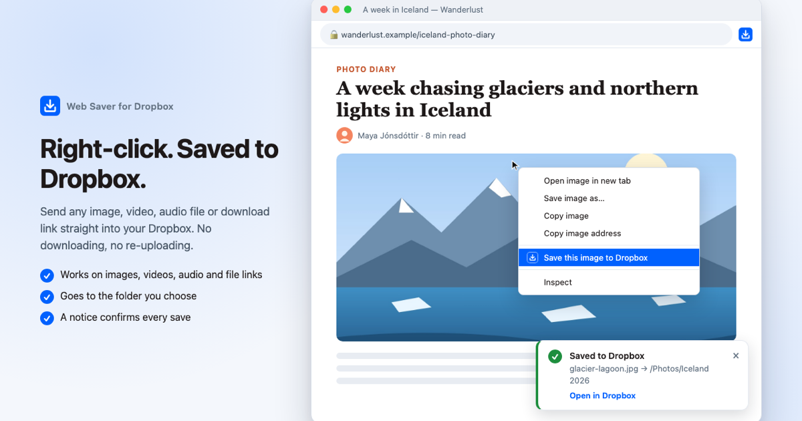

# Stop Downloading Just to Upload: Save Web Files Straight to Dropbox

You find the asset. You download it. You open Finder. You drag it into Dropbox. You delete the local copy.

Designers, researchers, and content people who live in Dropbox pay that tax all day.

**[Web Saver for Dropbox](https://chromewebstore.google.com/detail/web-saver-for-dropbox/hpgokiookclncalkhobnlpcgfnafjhbi)** is a free, MIT open-source Chromium extension that skips it. Right-click a file, image, or link and send it straight into the Dropbox folder you choose. You connect your own Dropbox app once; keys stay in your browser. No Web Saver server.

Independent project — not affiliated with Dropbox, Inc.

> **TL;DR**
>
> **Free.** MIT open source. Chrome, Brave, and Edge.
>
> **Best for:** people who already work in Dropbox and save web images, PDFs, and assets often.
>
> **Pricing:** Free. One-time Dropbox app setup (~3 minutes).
>
> **Install:** [Chrome Web Store](https://chromewebstore.google.com/detail/web-saver-for-dropbox/hpgokiookclncalkhobnlpcgfnafjhbi) · [GitHub](https://github.com/oyerohabib/dropbox-web-saver)

> **Key Takeaways**
>
> - Right-click (or batch-scan a page) → file lands in *your* Dropbox.
> - The ~3-minute Dropbox app setup is the privacy feature: App key + tokens stay in your browser.
> - Setup guide, limitations, and privacy policy are in the [README](https://github.com/oyerohabib/dropbox-web-saver#dropbox-app-setup).

## The download-then-upload tax is real

People have asked for years whether they can [save from a URL straight into Dropbox](https://community.dropbox.com/en/discussion/437221/saving-images-directly-from-website) without downloading first. Most workarounds still dump files on your disk, then make you upload again. Web Saver removes that hop.

## What it does

1. Install and connect *your* Dropbox app (built-in guide).
2. Right-click an image, video, audio element, or downloadable file link — or **Find files on this page** to batch-save.
3. Optionally rename and pick a folder, then save.
4. Open it in Dropbox from the in-page toast.

### Features

- **Right-click save** for images, video, audio, and file links (PDFs, docs, archives, design files, and more)
- **Find files on this page** — tick thumbnails, save several at once
- **Review before save** — rename, browse folders, create a folder, set a default
- **Your credentials, your browser** — PKCE OAuth with *your* App key (no App secret); no analytics server
- **`activeTab` only** — touches the tab you save from, not every site at install
- **Open source** — [inspect the code](https://github.com/oyerohabib/dropbox-web-saver)

### How uploads work

Public files can be imported by Dropbox from the URL. Private or same-site files are fetched with the page’s session and uploaded from your browser. That hybrid path covers more saves — and is why streamed / `blob:` video (YouTube-style players) often will not work today.

## Supported files

Right-clicking an image, video, or audio element saves it whatever its format — the extension uses the file the element is showing.

Links and **Find files on this page** recognise files by the extension in the URL:

| Type | Extensions |
| --- | --- |
| Images | jpg, jpeg, png, gif, webp, avif, heic, heif, svg, bmp, tif, tiff |
| Video | mp4, webm, mov, m4v, mkv, avi, mpeg, mpg, ogv, 3gp |
| Audio | mp3, m4a, aac, wav, ogg, oga, opus, flac |
| Documents | pdf, doc, docx, xls, xlsx, ppt, pptx, odt, ods, odp, rtf, txt, csv, epub |
| Archives | zip, rar, 7z, tar, gz |
| Design files | psd, ai, eps, fig, sketch, xd |

A link to any other file still works when it has a `download` attribute, or when the site sends it as a download rather than a web page. Streamed video and `blob:` sources can’t be saved yet — see [known limitations](https://github.com/oyerohabib/dropbox-web-saver#known-limitations).

## The setup is the privacy product

Most “save to cloud” tools rush you live and hide where tokens sit. [Research](https://news.gatech.edu/news/2024/09/17/study-finds-thousands-browser-extensions-compromise-user-data) keeps finding extensions that pull page data — and some that send it to servers.

Web Saver does the opposite:

1. Create a Dropbox app (once). The in-extension guide has copy buttons.
2. Paste **your App key** (never the App secret — PKCE does not need it).
3. Connect Dropbox and click Allow.
4. Key and tokens stay in your browser storage. No Web Saver server. No analytics.

Three minutes of setup buys you **browser → Dropbox API → your account**, with no founder backend in the middle. Full steps: [Dropbox app setup](https://github.com/oyerohabib/dropbox-web-saver#dropbox-app-setup). Policy: [PRIVACY.md](https://github.com/oyerohabib/dropbox-web-saver/blob/main/PRIVACY.md).

## Who should install it today

**Install if you:**

- Keep projects, brand kits, or research in Dropbox
- Save web images, PDFs, and assets often
- Use Chrome, Brave, or Edge
- Want credentials under your control

**Coming in future versions:**

- Firefox and Safari support
- Better handling of streamed / blob video
- Multi-cloud save with less setup friction
- **Google Drive support** (next cloud destination after Dropbox)

Current limits: [known limitations](https://github.com/oyerohabib/dropbox-web-saver#known-limitations).

## FAQ

### Do I need a paid Dropbox plan?

You need a Dropbox account the API can write to. Plan limits are Dropbox’s. The extension is free either way.

### Why do I need my own App key?

Dropbox only talks to *an* app. Using **yours** means tokens are scoped to credentials you control — not a shared multi-tenant app on a middleman’s server.

### Will it save any video on a page?

No. Downloadable file links and most images work. Streamed players and `blob:` URLs usually will not — until that lands in a future version.

### Is this an official Dropbox product?

No. Independent MIT project by Oyero Habib. Not affiliated with, endorsed by, or sponsored by Dropbox, Inc.

## Get it

**[Install Web Saver for Dropbox](https://chromewebstore.google.com/detail/web-saver-for-dropbox/hpgokiookclncalkhobnlpcgfnafjhbi)** · **[View source on GitHub](https://github.com/oyerohabib/dropbox-web-saver)**

## About the author

I’m **Oyero Habib**, maintainer of Web Saver for Dropbox. I built it after a designer friend hit the same Download → Finder → Upload wall — it felt like a real problem, and I like shipping tools that remove that kind of friction. Code on [GitHub](https://github.com/oyerohabib/dropbox-web-saver); install on the [Chrome Web Store](https://chromewebstore.google.com/detail/web-saver-for-dropbox/hpgokiookclncalkhobnlpcgfnafjhbi). Feedback: [GitHub Issues](https://github.com/oyerohabib/dropbox-web-saver/issues) (preferred) or your product support email once you create one.
